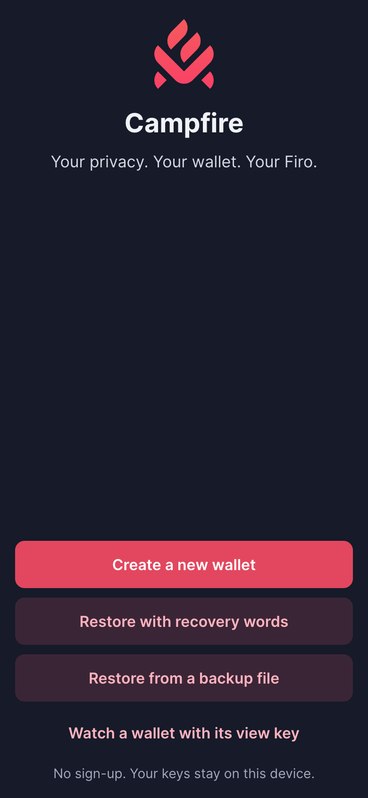
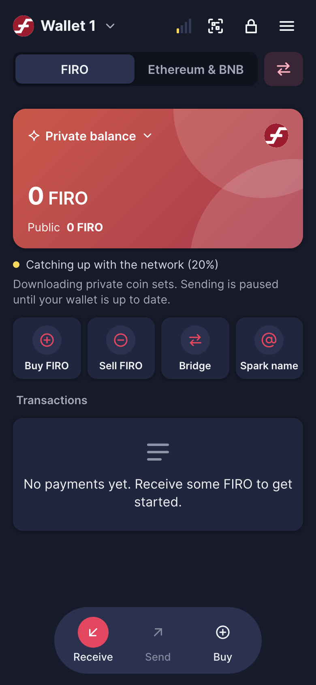
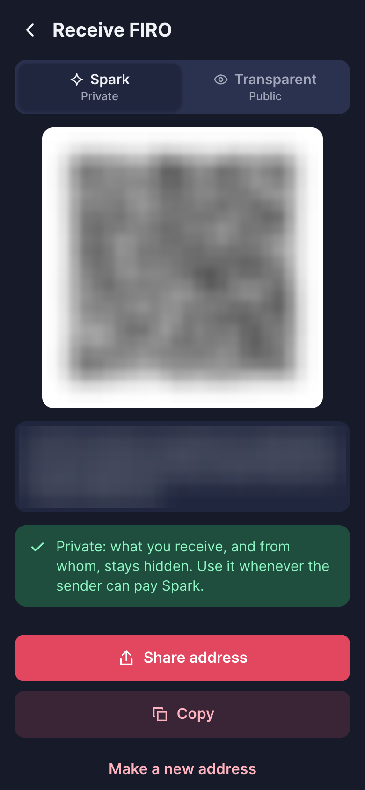
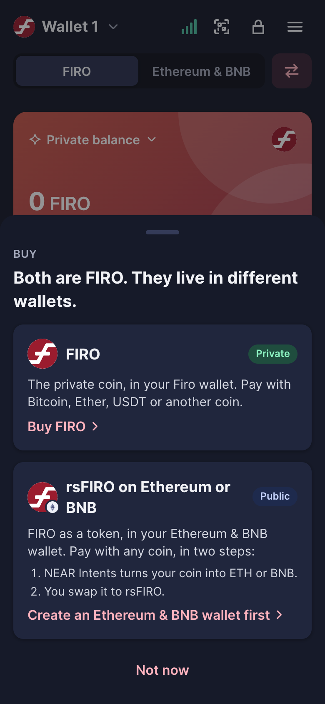
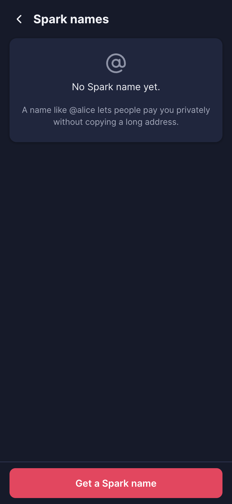
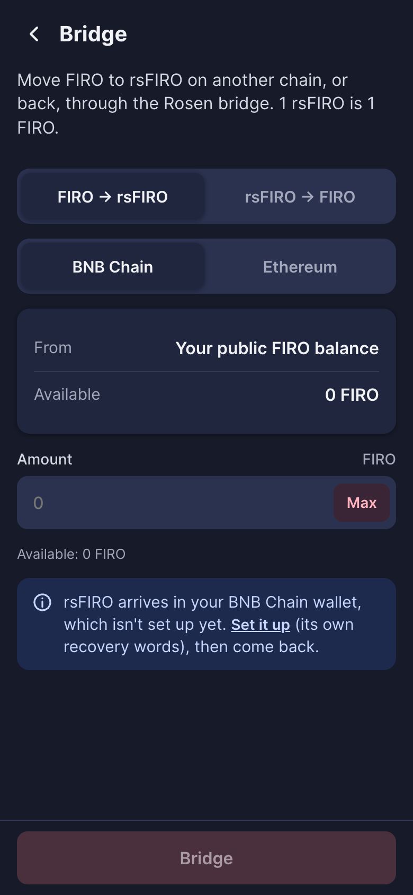
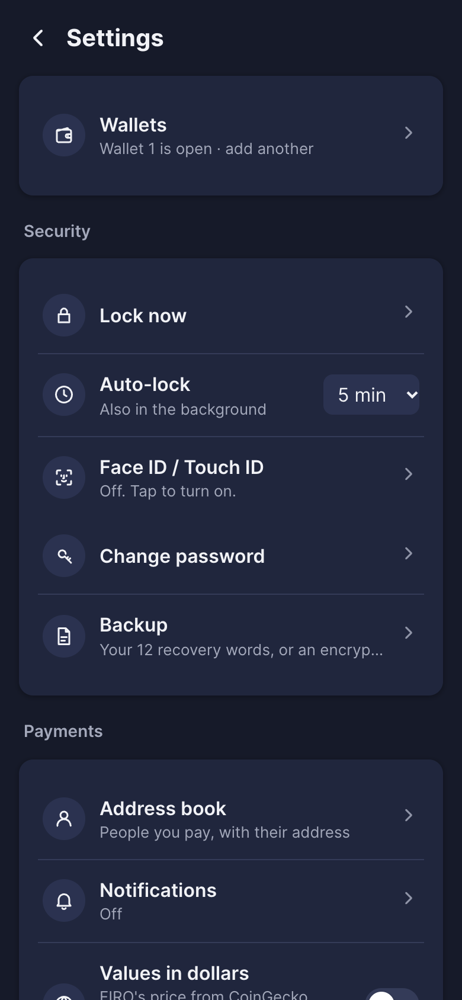
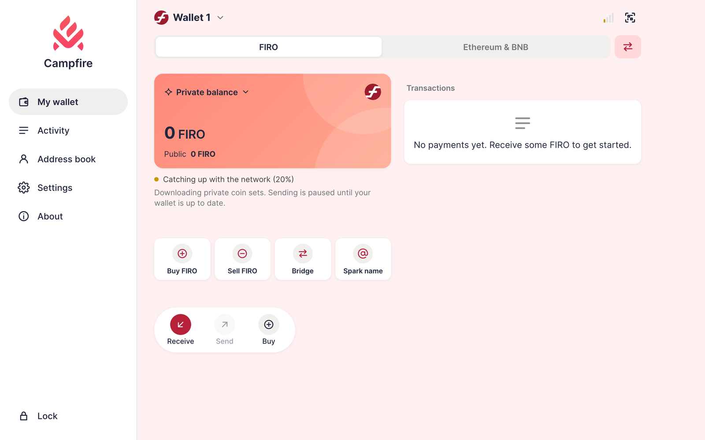

# Campfire for Firo — a private Firo wallet that runs in your browser

Your FIRO, private by default, on any phone or computer. Install it from a web page in one tap:
no app store can remove it, no account, no server that holds your keys.

> **Beta.** The test build runs at **https://pwa.buyfiro.app**. Use small amounts until it leaves beta.

<p>
  
  
  
  
</p>
<p>
  
  
  
</p>



*Real screenshots of the live test build with a new, empty wallet (no staged data); on Receive the QR
code and the address are blurred, so no one pays into a throwaway wallet. A new wallet shows
"Catching up with the network" while it downloads Firo's private coin sets.*

## What you can do

- **Pay privately with Spark.** Receive to a Spark address, move public FIRO into your private balance
  in one tap, send Spark to Spark with a private memo, or Spark to a public address.
- **Spark names.** Get a name like `@alice` so people can pay you privately without copying a long address.
- **Buy and sell FIRO** with Bitcoin, Ether, USDT and other coins (through buyfiro.app). Bought FIRO
  arrives in your public balance; the wallet then helps you make it private.
- **rsFIRO on Ethereum and BNB Chain.** An Ethereum & BNB wallet sits beside your Firo wallet, with its
  own recovery words: write those down too. Pay with almost any coin through NEAR Intents, then swap to
  rsFIRO (Uniswap / PancakeSwap).
- **Bridge FIRO ↔ rsFIRO** through the Rosen bridge, with the fee shown before you confirm.
- **Several wallets**, an address book, QR scanning, payment notifications on the device,
  Face ID / Touch ID unlock (passkeys), encrypted backup files, and a choice of Firo servers.

Not in this version yet: registering a masternode (Settings → Masternodes shows the ones you have).

## Proven on Firo mainnet

With real FIRO (small amounts), from this wallet: a public send, making FIRO private, Spark → Spark with
a memo, Spark → public, and registering a Spark name. buyfiro.app (its sandbox), NEAR Intents quotes and
every Ethereum / BNB server were tested live too. On Ethereum and on BNB Chain, from this wallet's
screens: a coin send, a token send, and buying and selling rsFIRO on Uniswap and PancakeSwap. The Rosen
bridge is tested against a simulation (its minimum fee makes a live test costly).

## How it keeps your coins safe

- **Your keys stay on your device**, encrypted with your password (scrypt). They are never sent anywhere.
  The app's own address only serves the app; Buy and Sell talk to buyfiro.app (run by the same author)
  only when you use them.
- **Every release is signed.** The app checks the signature and the hash of every file before it runs a
  new version, and a new version installs only when you tap *Check for updates*. If the web address ever
  serves a loader Campfire did not sign, the app stops and says so. If the address disappears, the
  installed app keeps working and can update from the signed copies on GitHub (it never runs from them).
- **Strict page rules** (Content-Security-Policy): the app can only talk to Firo's servers, the
  Ethereum and BNB Chain servers listed in Settings → Ethereum & BNB (seven for Ethereum, eight for BNB
  Chain, each checked live on its screen), CoinGecko (prices in dollars), the services named above, and
  a server of your own if you add one (Firo, Ethereum or BNB Chain: checked first, then allowed by the
  app's service worker, exactly that server's origin: scheme, host and port). Each one sees your IP
  address. Your address is the same on Ethereum and BNB Chain, and each chain's chosen server is asked
  about it (another listed server only checks swap prices, or settles a payment stuck in doubt - not
  while you use your own server on that chain). Stack Wallet's history index, on by default, is asked
  about your Ethereum address too, unless you turn it off or use your own Ethereum server.
- **Your recovery words never leave the device:** they are not logged and not sent anywhere.

## Run it yourself

```bash
npm ci                                   # dev/test tools only (playwright-core, jsqr); nothing ships from node_modules
node tools/keygen.mjs                    # once: a key pair for your own builds, in ~/.config/campfire-firo/ (0600)
node tools/build.mjs --dev               # src/ -> dist-dev/, signed with that pair
node tools/serve.mjs --port 8780 --root dist-dev   # http://localhost:8780/  (--fake-backend: the stand-in engine, no network)
npm test                                 # unit tests
```

Your build is signed with your own key, so no install of the published app takes it as an update.
The release key's public half is `keys/release_public.jwk`; `keygen.mjs` never replaces it.

Plain JavaScript, no framework, no bundler. Firo's Spark cryptography is compiled to WebAssembly
(`spark/`).

- `src/lib/chain.js` is the one place that picks the Firo engine: the stand-in
  (`src/lib/backend_fake.js`) or the real one (`src/lib/firo/backend.js`).
- Headers and the Content-Security-Policy come from one list, `tools/headers.mjs`
  (`deploy/_headers` and `deploy/nginx.conf` are checked against it by the build).
- Browser tests (`test/e2e/`) drive the real screens in Chrome; `test/live/` holds the mainnet tests
  (they spend real coins and run only when asked).

## Licence

MIT (see `LICENSE`), except the logos in `src/img` (see `src/img/LICENSE.txt`) and the third-party code
under `src/vendor`, which keep their own licences. Built on the BEAM Campfire web wallet by the same
author; the Firo parts are written from Firo Core and sparkmobile (both MIT). Some comments name files
of the Campfire app (Dart): they point to behaviour this app matches (address shapes, link parameters,
defaults), not to code taken from it.
